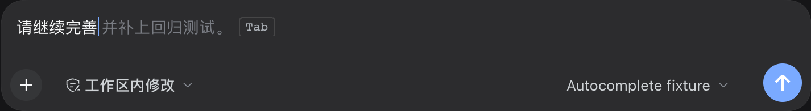

# DeepSeek Harness 对话框自动补全

[English](README.md) | **简体中文**

[](https://github.com/liangzhiyu/dsh-composer-autocomplete/actions/workflows/ci.yml)
[](LICENSE)

`dsh-composer-autocomplete` 给 DeepSeek Harness Web 聊天输入框增加灰字续写和下一句预测：**Tab** 采纳、**Esc** 关闭、**Alt+↓ / Alt+↑** 切换候选。采纳只写入可编辑草稿，不会发送消息。

采用 [MIT 许可证](LICENSE)。预测默认使用会话已配置的模型，会消耗相应服务的用量。



截图来自真实 Harness 界面，演示使用本地确定性测试模型。

## 安装

已验证环境：Node.js ≥ 24.9、DeepSeek Harness `0.2.1-rc.2` Web。安装 [GitHub Release](https://github.com/liangzhiyu/dsh-composer-autocomplete/releases/latest) 中的预构建包：

```sh
dsh plugin --profile web add https://github.com/liangzhiyu/dsh-composer-autocomplete/releases/download/v0.2.3/dsh-composer-autocomplete-0.2.3.tgz
dsh web
```

安装后重启已运行的 Harness。官方桌面端请使用其「插件 → 安装」入口选择本地安装包，或使用该桌面安装附带的 dsh 命令管理 desktop profile。桌面载体未实机验证；Web 侧的代码共用原生输入框插槽。

## 使用

- 空输入框：一轮回复完成后显示下一句建议。
- 输入草稿：光标停在末尾，默认停顿 150 毫秒后请求续写。
- 快速模式（默认）：只生成一条候选，缩小上下文与输出预算；完整模式保留多候选及配置的上下文上限。
- **Tab**：首条完整候选生成后即可采纳，无需等待其他候选；仍需自己按 Enter 发送。
- **Alt+↓ / Alt+↑**：在完整模式中切换最多三条候选。
- **Esc**：隐藏本次建议；继续输入后可重新预测。
- **设置 → 通用设置 → 输入预测**：总开关、下一句预测、输入续写、快速／完整模式和停顿时间（100–5000 毫秒）分别可调。

设置保存在当前浏览器／设备中。支持中文输入法；拼音组合期间不抢占 Tab。不在 Agent 运行期间预测，不干扰 `/命令` 和 `@引用` 菜单；修改草稿、切换会话、关闭功能会取消旧请求。草稿始终通过 Harness 的插入 API 更新，拒绝插入时保留原文。

页面切到后台时也会取消请求。新版本保留原有的停顿设置；默认 150 ms 只适用于尚未保存设置的浏览器。升级后若仍保存为 300 ms，可在设置中改成 150 ms。

顺着已完成候选的准确前缀继续输入时，直接在本地复用剩余文字，不增加模型调用。输入不同内容会使它失效，输入法组合期间继续暂停提示。

灰字提示显示时保留输入框原生光标；采纳后光标停在插入内容末尾，可以继续输入、用方向键移动或点击其他位置编辑。

切换会话时会在绘制前清空候选，并重置输入法与关闭状态。每条候选绑定所属会话、草稿和请求，旧请求晚到也无法覆盖或被采纳。结果缓存按会话 ID、会话序号、预测模式、草稿及快速／完整设置隔离；切回原会话时可复用其有效缓存，新一轮消息会使旧版本缓存失效。

## 延迟与优化

在相同的本地测试模型下，从输入停止开始计时，每组 6 次取中位数：

| 版本／设置 | 首次灰字 | 可按 Tab |
| --- | ---: | ---: |
| 0.2.2，停顿 300 ms | 405 ms | 426 ms |
| 0.2.3 快速模式，停顿 150 ms | 256 ms | 277 ms |
| 0.2.3 快速模式，停顿 100 ms | 205 ms | 235 ms |

匹配已有候选的逐字输入测得约 11 ms 更新提示，无网络请求，取六次输入的中位数。

这是本地确定性模型的 UI／SSE 链路测量，不代表真实 DeepSeek API 的速度或质量。实际延迟还取决于网络、模型首 token 时间、输出格式与生成速度。原始数据及方法见 [优化说明](docs/optimization.md)。更短的停顿也可能增加请求次数，可在设置中调回更长间隔。

## 模型和用量

预测复用会话的模型路由和宿主认证，不另存 API key。它会把近期对话、近期工具结果和当前草稿发送给已配置的模型，并消耗 token；这类辅助请求不会加入对话记录或计入会话的 token 显示。要运行真实预测，请先在 Harness 中配置可用模型。

可在 profile 的 `cordis.patch.yml` 中覆盖宿主参数：

如果当前主模型思考较慢，可以同时设置下方的 `provider` 和 `model`，让补全单独使用已配置的快速模型，主会话模型不变。快速模式将配置上限进一步限制为一条候选、6 条消息、4000 个上下文字符、2 条工具记录和 96 个输出 token；完整模式使用配置中的上限。

```yaml
- id: composer-autocomplete
  config:
    maxOutputTokens: 220
    timeoutMs: 20000
    maxMessages: 10
    maxChars: 8000
    maxSuggestions: 3
    maxToolNotes: 6
    cacheTtlMs: 60000
    maxCacheEntries: 200
    # 同时指定以下两项可固定辅助模型，否则跟随会话。
    # provider: your-provider
    # model: your-model
    # reasoningEffort: off
```

## 开发与验证

插件是原生 ESM／Harness 浏览器模块，无需编译或生产依赖。

```sh
node --test test/*.test.mjs
node tools/check-package.mjs
pnpm pack --pack-destination artifacts
```

真实浏览器验证使用 Playwright 驱动 Chromium，在安装了插件的 Harness Web 上检查键盘交互、输入法、设置与草稿行为。运行前安装 Playwright，并提供隔离测试实例地址：

```sh
pnpm install --frozen-lockfile
DSH_URL=http://127.0.0.1:3087 node tools/browser-smoke.mjs
DSH_URL=http://127.0.0.1:3087 node tools/session-switch-smoke.mjs
DSH_URL=http://127.0.0.1:3087 node tools/caret-smoke.mjs
DSH_URL=http://127.0.0.1:3087 node tools/speed-smoke.mjs
```

光标检查会保留截图中的原生光标。安装 Pillow 后，可执行 `python3 tools/verify-caret-pixels.py` 核对光标位置的实际像素。

验证范围和结果见 [docs/verification.md](docs/verification.md)，版本变更见 [CHANGELOG.md](CHANGELOG.md)。

## 卸载

```sh
dsh plugin --profile web remove dsh-composer-autocomplete
```

重启对应实例。浏览器设置会保留，可在开发者工具中删除 `dsh-composer-autocomplete.*` 存储键。
